<div align="center">  
  <h1>ROBOT EDUCATION INDONESIA ESP32 STACK MODULE</h1>
</div>

# MANUAL BOOK - EARLY LEVEL

Materi pada level pemula ini berfokus pada fondasi dasar pemrograman mikrokontroler menggunakan **ESP32 Core Module**, manajemen Digital Input/Output, Analog Input (ADC), serta komunikasi Serial debugging menggunakan serial monitor.

## 🚀 Daftar Isi Modul Pembelajaran

* [**Persiapan Software**](#persiapan-software)
1. [Core Module (ESP32 Base)](#1-core-module-esp32-base)
2. [Modul Push Button (Direct IO)](#2-modul-push-button-direct-io)
3. [Modul Running Light](#3-modul-running-light)
4. [Modul Potentiometer & Rotary Encoder](#4-modul-potentiometer--rotary-encoder)
5. [Modul 7-Segment Display](#5-modul-7-segment-display)
6. [Modul Temperature (ADC/Sensor Dasar)](#6-modul-temperature-adcsensor-dasar)
7. [CAPSTONE PROJECT LEVEL 1](#-capstone-project-level-1-digital-thermohygrometer)

---

## Persiapan Software

Untuk mulai belajar dan mengunggah program ke ESP32, ikuti langkah instalasi berikut:

1. **Download Arduino IDE**
   - Buka situs resmi Arduino: https://www.arduino.cc/en/software
   - Pilih paket instalasi untuk Windows dan unduh file installer.
   - Jalankan installer, lalu ikuti panduan sampai selesai.

2. **Jalankan Arduino IDE**
   - Setelah instalasi, buka aplikasi Arduino IDE.
   - Jika muncul jendela `Welcome`, tutup atau lewati.

3. **Tambah Board ESP32 di Arduino IDE**
   - Buka menu `File` > `Preferences`.
   - Pada kolom `Additional Boards Manager URLs`, tambahkan URL berikut:
     `https://raw.githubusercontent.com/espressif/arduino-esp32/gh-pages/package_esp32_index.json`
   - Klik `OK`.

4. **Install ESP32 Board Package**
   - Buka `Tools` > `Board` > `Boards Manager...`.
   - Ketik `esp32` di kotak pencarian.
   - Pilih `esp32 by Espressif Systems`, lalu klik `Install`.
   - Tunggu hingga proses pemasangan selesai.

5. **Pilih Board ESP32 dan Port**
   - Buka `Tools` > `Board` dan pilih board yang sesuai, misalnya `ESP32 Dev Module`.
   - Hubungkan board ESP32 ke komputer dengan kabel USB.
   - Buka `Tools` > `Port` dan pilih COM port yang terkait dengan ESP32.

6. **Uji Contoh Program**
   - Buka `File` > `Examples` > `01.Basics` > `Blink`.
   - Klik tombol `Upload` (ikon panah kanan) untuk mengunggah program ke ESP32.
   - Jika berhasil, LED internal ESP32 (biasanya GPIO 2) akan berkedip.

> Tips: Jika muncul pesan kesalahan koneksi, tekan dan tahan tombol `BOOT` pada board ESP32 saat proses upload berlangsung.

---

## 1. Core Module (ESP32 Base)
* **Overview:** Pengenalan unit pemroses utama (otak) dari seluruh ekosistem trainer kit Robotics RE.
* **Spesifikasi & Breakdown Komponen:** IC ESP32-WROOM-32, regulator tegangan terintegrasi, 2 Pin Servo, dan GPIO.
* **Pinout Diagram:** 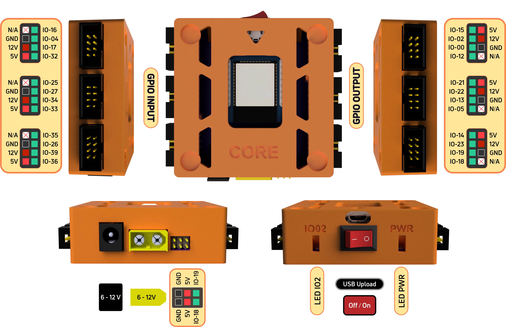
* **Pengujian Hardware:** Menjalankan program dasar `Blink` menggunakan LED internal (GPIO 2).
* **Penjelasan Logika:** Pemahaman fungsi esensial `pinMode()`, `digitalWrite()`, dan `delay()`.
* **Troubleshooting:** Mengatasi kendala "A fatal error occurred: Failed to connect to ESP32: Timed out waiting for packet header" dengan menekan tombol BOOT saat flashing.
* **Contoh Program Dasar:**
  ```cpp
  #define LED_PIN 2

  void setup() {
    pinMode(LED_PIN, OUTPUT);
  }

  void loop() {
    digitalWrite(LED_PIN, HIGH);
    delay(1000);
    digitalWrite(LED_PIN, LOW);
    delay(1000);
  }
  ```

## 2. Modul Push Button (Direct IO)
* **Overview:** Modul ini digunakan untuk mengenalkan logika pembacaan input (ON/OFF).
* **Spesifikasi & Breakdown:** Saklar tekan (*tactile switch*) dengan konfigurasi pull-up/pull-down resistor eksternal.
* **Pinout Diagram:** 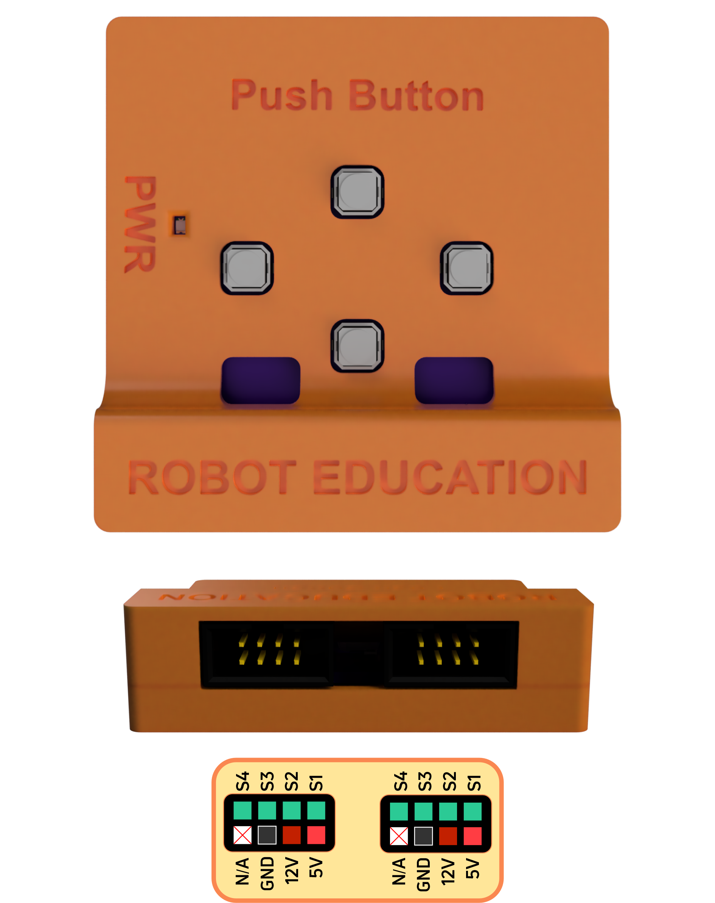
* **Wiring Diagram:** Menghubungkan pin keluaran saklar langsung ke pin GPIO input Core Module. 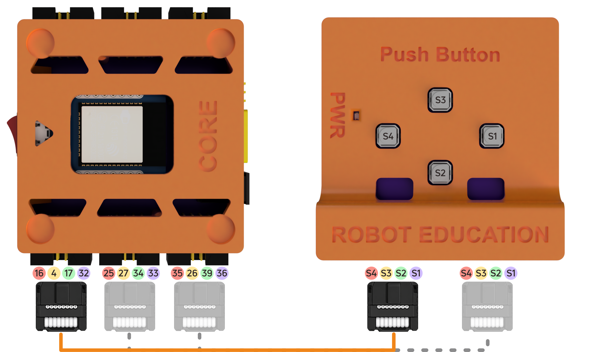
* **Pengujian Hardware:** Memantau perubahan status logika tombol (0 atau 1) lewat Serial Monitor.
* **Penjelasan Logika:** Penggunaan fungsi `digitalRead()` dikombinasikan dengan struktur percabangan `if-else`.
* **Troubleshooting:** Penanganan efek ketidakstabilan mekanis saklar (*bouncing*) menggunakan teknik debouncing berbasis software (`delay` mikro).
* **Contoh Program Dasar:**
  ```cpp
  #define LED_PIN 2
  
  // Array untuk menyimpan pin dari ke-4 tombol
  const int buttonPins[] = {16, 4, 17, 32};
  const int numButtons = 4;
  
  // Menyimpan status sebelumnya untuk setiap tombol dan status LED
  int lastButtonState[] = {HIGH, HIGH, HIGH, HIGH};
  bool ledState = false;
  
  void setup() {
    Serial.begin(115200);
    Serial.println("Program Tombol dan LED dimulai. Tekan tombol untuk mengubah status LED.");
    pinMode(LED_PIN, OUTPUT);
    
    for (int i = 0; i < numButtons; i++) {
      pinMode(buttonPins[i], INPUT_PULLUP);
    }
  }
  
  void loop() {
    for (int i = 0; i < numButtons; i++) {
      int currentState = digitalRead(buttonPins[i]);
      
      // Deteksi jika tombol baru saja ditekan (transisi dari HIGH ke LOW)
      if (currentState == LOW && lastButtonState[i] == HIGH) {
        ledState = !ledState; // Balikkan status LED (Toggle)
        digitalWrite(LED_PIN, ledState);
        
        Serial.print("Tombol di pin ");
        Serial.print(buttonPins[i]);
        Serial.println(" ditekan. LED di-toggle!");
        
        delay(50); // Jeda singkat untuk debouncing
      }
      
      // Simpan status saat ini untuk iterasi berikutnya
      lastButtonState[i] = currentState;
    }
  }
  ```
* **Hasil yang Diharapkan:** Saat salah satu dari empat tombol ditekan, status LED pada pin 2 akan berganti (*toggle*). Pesan yang menginformasikan nomor pin tombol yang ditekan juga akan muncul di Serial Monitor.

## 3. Modul Running Light
* **Overview:** Praktikum mengontrol banyak keluaran digital sekaligus menggunakan struktur data larik (*array*).
* **Spesifikasi & Breakdown:** 9 Unit LED berderet, 3 Unit Push Button Direct, dan 1 Unit Potensiometer pembagi tegangan.
* **Pinout Diagram:** 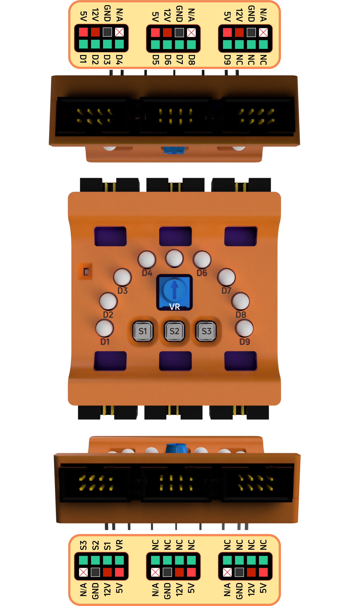
* **Wiring Diagram:** Pemetaan multi-jalur dari pin anoda LED ke deretan pin digital output ESP32. 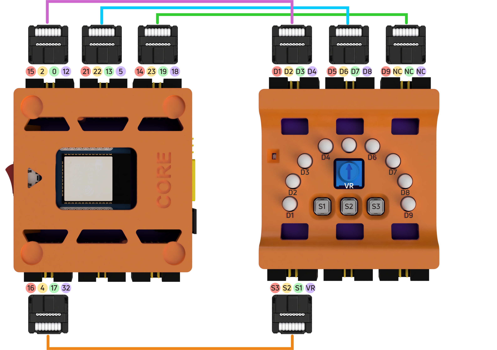
* **Pengujian Hardware:** Test sekuensial awal untuk memastikan seluruh 9 LED dapat menyala bergantian.
* **Penjelasan Logika:** Implementasi algoritma perulangan (`for loop`) untuk menggeser indeks LED aktif, serta memanfaatkan nilai pembacaan potensiometer untuk memanipulasi kecepatan pergeseran lampu.
* **Troubleshooting:** Redupnya sebagian LED akibat pembagian arus kerja, pastikan nilai resistor pembatas arus sudah sesuai spesifikasi.
* **Contoh Program Dasar:**
  ```cpp
  #define POT_PIN 32

  int ledPins[] = {15, 2, 0, 12, 21, 22, 13, 5, 14};
  int numLeds = 9;
  
  int buttonPins[] = {16, 4, 17};
  int numButtons = 3;
  
  void setup() {
    Serial.begin(115200);
    
    for (int i = 0; i < numLeds; i++) {
      pinMode(ledPins[i], OUTPUT);
    }
    
    for (int i = 0; i < numButtons; i++) {
      pinMode(buttonPins[i], INPUT_PULLUP);
    }
  }
  
  void loop() {
    int potValue = analogRead(POT_PIN);
    Serial.print("Potensiometer: ");
    Serial.print(potValue);
    
    // Print status dari masing-masing tombol
    for (int i = 0; i < numButtons; i++) {
      Serial.print(" | Tombol ");
      Serial.print(buttonPins[i]);
      Serial.print(": ");
      Serial.print(digitalRead(buttonPins[i]));
    }
    Serial.println(); // Pindah baris di Serial Monitor
    
    // Nyalakan semua LED
    for (int i = 0; i < numLeds; i++) {
      digitalWrite(ledPins[i], HIGH);
    }
    delay(500);
    
    // Matikan semua LED
    for (int i = 0; i < numLeds; i++) {
      digitalWrite(ledPins[i], LOW);
    }
    delay(500);
  }
  ```
* **Hasil yang Diharapkan:** Kesembilan LED akan menyala berkedip (*blink*) secara serentak setiap setengah detik. Di saat yang sama, Serial Monitor akan terus-menerus mencetak nilai pembacaan dari potensiometer dan status logika ketiga tombol *push button*.

## 4. Modul Potentiometer & Rotary Encoder
* **Overview:** Komparasi karakteristik kendali masukan berbasis perubahan resistansi kontinu (Analog) melawan sensor rotasi digital tanpa batas (*Rotary Encoder*).
* **Spesifikasi & Breakdown:** Potensiometer linier 10k Ohm dan komponen Rotary Encoder mekanis yang dilengkapi saklar tekan internal.
* **Pinout Diagram:** 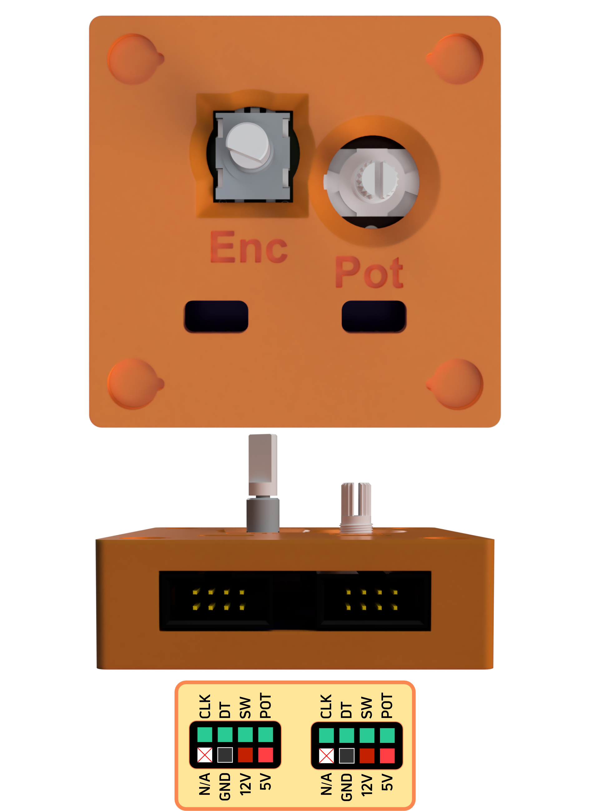
* **Wiring Diagram:** Jalur tengah potensiometer ke pin berkapabilitas ADC, serta pin fasa A dan B encoder ke pin berkemampuan Interrupt. 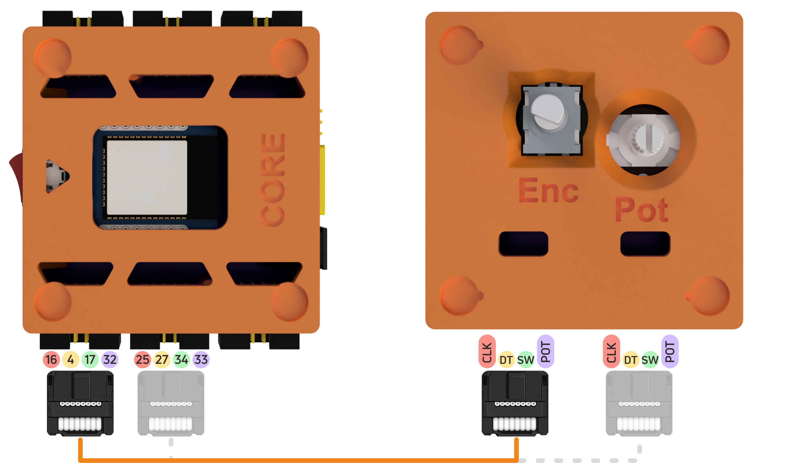
* **Pengujian Hardware:** Visualisasi pembacaan sinyal kontinu potensiometer menggunakan fitur Serial Plotter Arduino IDE.
* **Penjelasan Logika:** Konsep konversi data fisik lewat fungsi `analogRead()` (resolusi default ESP32 12-bit) dan fungsi interupsi perangkat keras `attachInterrupt()`.
* **Troubleshooting:** Menghilangkan noise nilai ADC yang fluktuatif dengan metode pemfilteran rata-rata bergerak (*moving average filter*) pada software.
* **Contoh Program Dasar:**
  ```cpp
  #define POT_PIN 34
  #define CLK_PIN 16
  #define DT_PIN 4
  #define SW_PIN 17
  
  volatile int encoderCounter = 0;
  
  // Fungsi Interupsi (Interrupt) untuk membaca putaran Rotary Encoder
  void IRAM_ATTR readEncoder() {
    if (digitalRead(DT_PIN) == HIGH) {
      encoderCounter++; // Putar ke kanan (Clockwise)
    } else {
      encoderCounter--; // Putar ke kiri (Counter-Clockwise)
    }
  }
  
  void setup() {
    Serial.begin(115200);
    
    pinMode(CLK_PIN, INPUT_PULLUP);
    pinMode(DT_PIN, INPUT_PULLUP);
    pinMode(SW_PIN, INPUT_PULLUP);
    
    // Panggil fungsi readEncoder setiap kali sinyal CLK berubah dari HIGH ke LOW (FALLING)
    attachInterrupt(digitalPinToInterrupt(CLK_PIN), readEncoder, FALLING);
  }
  
  void loop() {
    if (digitalRead(SW_PIN) == LOW) {
      Serial.println("Tombol Encoder Ditekan! Mereset nilai menjadi 0.");
      encoderCounter = 0; // Reset nilai putaran ketika tombol ditekan
      delay(200); // Debounce sederhana
    }

    int potValue = analogRead(POT_PIN);
    Serial.print("Potensiometer: ");
    Serial.print(potValue);
    Serial.print(" | Posisi Encoder: ");
    Serial.println(encoderCounter);
    
    delay(100);
  }
  ```
* **Hasil yang Diharapkan:** Serial Monitor akan menampilkan nilai dari potensiometer (0-4095) dan *rotary encoder*. Nilai posisi *encoder* akan bertambah/berkurang sesuai arah putaran, dan akan direset kembali ke angka nol (0) jika tombol saklar pada *encoder* ditekan.

## 5. Modul 7-Segment Display
* **Overview:** Pemahaman cara kerja penampil angka digital klasik untuk menampilkan data keluaran secara ringkas.
* **Spesifikasi & Breakdown:** Display 7-Segment multi-digit konfigurasi Common Anode/Cathode (atau modul terintegrasi driver chip).
* **Pinout Diagram:** 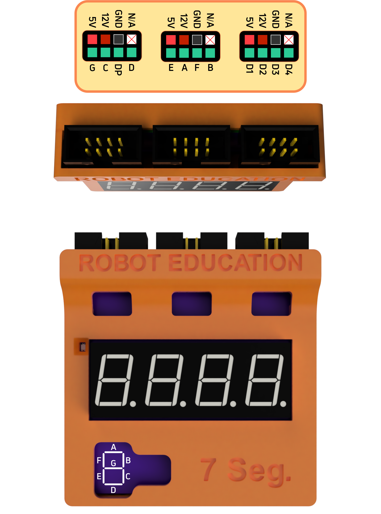
* **Wiring Diagram:** Jalur bus segmen A sampai G serta pin kontrol digit menuju deretan pin keluaran Core Module. 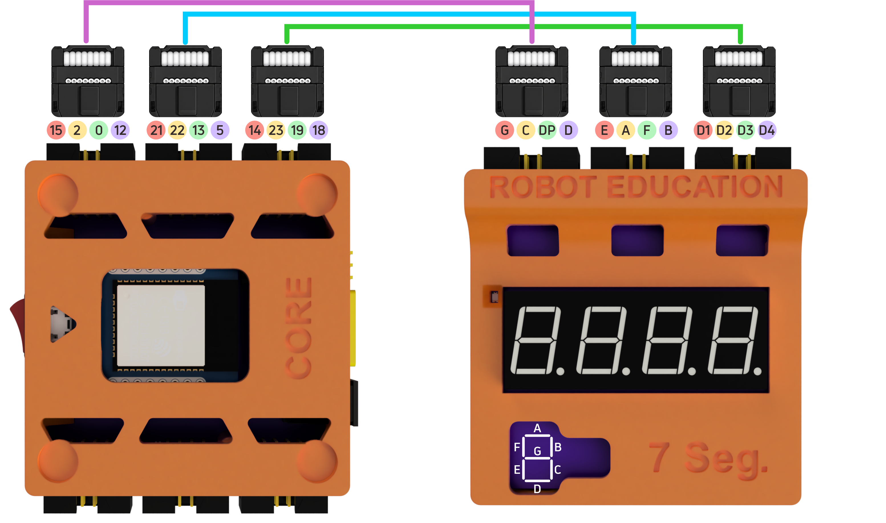
* **Pengujian Hardware:** Membuat siklus hitung numerik otomatis dari angka 0 hingga 9.
* **Penjelasan Logika:** Teknik pemindaian bergantian cepat (*multiplexing*) untuk menghemat penggunaan GPIO mikrokontroler.
* **Troubleshooting:** Munculnya bayangan angka (*ghosting*) pada display, perbaiki jeda waktu pengosongan data (*clearing*) sebelum berpindah digit.
* **Contoh Program Dasar:**
  ```cpp
  int pinA = 22, pinB = 5, pinC = 2, pinD = 12, pinE = 21, pinF = 13, pinG = 15, pinDP = 0;
  int digitPins[] = {14, 23, 19, 18}; // Pin kontrol untuk Digit 1 hingga 4
  
  void setup() {
    int segmentPins[] = {pinA, pinB, pinC, pinD, pinE, pinF, pinG};
    for(int i = 0; i < 7; i++) {
      pinMode(segmentPins[i], OUTPUT);
    }
    
    // Inisialisasi pin kontrol digit
    for(int i = 0; i < 4; i++) {
      pinMode(digitPins[i], OUTPUT);
      digitalWrite(digitPins[i], HIGH); // Aktifkan digit (Asumsi Common Cathode, beri HIGH jika Common Anode)
    }
  }
  
  void loop() {
    // Tampilkan angka 8 (Semua segment menyala)
    digitalWrite(pinA, HIGH); digitalWrite(pinB, HIGH);
    digitalWrite(pinC, HIGH); digitalWrite(pinD, HIGH);
    digitalWrite(pinE, HIGH); digitalWrite(pinF, HIGH);
    digitalWrite(pinG, HIGH); digitalWrite(pinDP, HIGH);
    delay(1000);
    
    // Tampilkan angka 1 (Hanya B dan C menyala)
    digitalWrite(pinA, LOW); digitalWrite(pinB, HIGH);
    digitalWrite(pinC, HIGH); digitalWrite(pinD, LOW);
    digitalWrite(pinE, LOW); digitalWrite(pinF, LOW);
    digitalWrite(pinG, LOW); digitalWrite(pinDP, LOW);
    delay(1000);
  }
  ```

* **Hasil yang Diharapkan:** Keempat digit pada 7-Segment akan menyala bersamaan menampilkan angka "8" lengkap dengan titiknya (*decimal point*) selama 1 detik, kemudian bergantian menampilkan angka "1" tanpa titik selama 1 detik, secara berulang.

## 6. Modul Temperature (ADC/Sensor Dasar)
* **Overview:** Mengukur variabel fisis suhu lingkungan sekitar menggunakan sensor solid-state.
* **Spesifikasi & Breakdown:** IC sensor suhu analog (seperti LM35) atau sensor suhu-kelembaban digital baris tunggal (seperti keluarga DHT).
* **Pinout Diagram:** 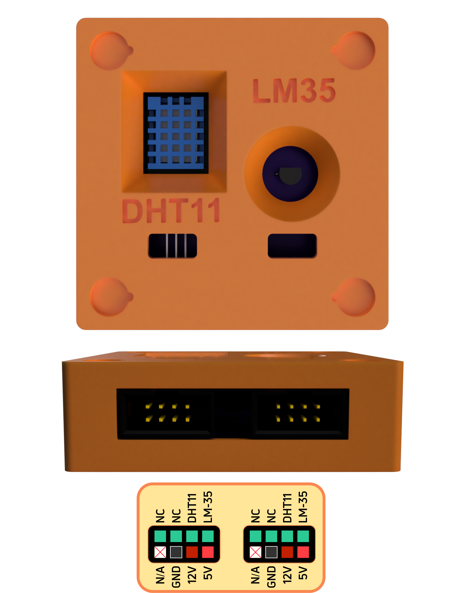
* **Wiring Diagram:** Pin keluaran data sensor terhubung ke port input mikrokontroler. 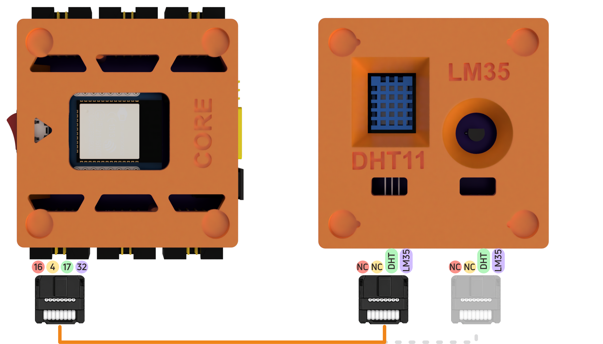
* **Pengujian Hardware:** Menampilkan pembacaan suhu ruangan real-time ke Serial Monitor dalam satuan derajat Celcius.
* **Penjelasan Logika:** Rumus kalkulasi matematis untuk mengonversi tegangan mV/ADC mentah menjadi representasi unit suhu fisis.
* **Troubleshooting:** Output sensor bernilai konstan atau pembacaan `-999`, periksa kestabilan tegangan referensi daya sensor.
* **Contoh Program Dasar:**
  ```cpp
   #include "DHT.h"

   #define DHT_PIN 17 // Gunakan pin 17 karena mendukung I/O dua arah
   #define DHT_TYPE DHT11
   #define LM35_PIN 32

   DHT dht(DHT_PIN, DHT_TYPE);

   void setup() {
      Serial.begin(115200);
      dht.begin();
   }

   void loop() {
      // Pembacaan sensor LM35 (Analog)
      // Menggunakan analogReadMilliVolts untuk mendapatkan nilai mV yang terkalibrasi pabrik (eFuse)
      float voltage_mV = analogReadMilliVolts(LM35_PIN);
      float tempLM35 = voltage_mV / 10.0;         // 10mV per derajat Celcius
      
      // Pembacaan sensor DHT11 (Digital)
      float tempDHT = dht.readTemperature();
      float humDHT = dht.readHumidity();

      Serial.print("Suhu LM35: ");
      Serial.print(tempLM35);
      
      // Cek apakah pembacaan DHT berhasil
      if (isnan(tempDHT) || isnan(humDHT)) {
         Serial.println(" C | Gagal membaca dari sensor DHT11!");
      } else {
         Serial.print(" C | Suhu DHT11: ");
         Serial.print(tempDHT);
         Serial.print(" C | Kelembaban DHT11: ");
         Serial.print(humDHT);
         Serial.println(" %");
      }
      
      delay(2000); // DHT11 butuh jeda waktu minimal 2 detik antar pembacaan
   }
  ```
* **Hasil yang Diharapkan:** ESP32 akan membaca data dari sensor analog LM35 serta sensor digital DHT11. Hasil konversi suhu (dari kedua sensor) dan tingkat kelembapan (dari DHT11) akan dicetak berurutan ke Serial Monitor setiap dua detik sekali.

---
## 🏆 CAPSTONE PROJECT LEVEL 1: Digital Thermohygrometer
* **Deskripsi:** Integrasi dari Modul Core, Modul Temperature (Sensor DHT11), dan Modul 7-Segment Display.
* **Alur Logika:** ESP32 membaca data suhu dan kelembapan ruangan secara berkala dari sensor DHT11. Nilai suhu (dalam Celcius) ditampilkan pada 2 digit pertama 7-segment, dan nilai kelembapan (dalam persentase) ditampilkan pada 2 digit terakhir. Program ini menerapkan fungsi `millis()` sebagai timer non-blocking untuk membaca sensor setiap 2 detik tanpa menghentikan siklus *multiplexing* 7-segment.
* **Wiring Diagram:**  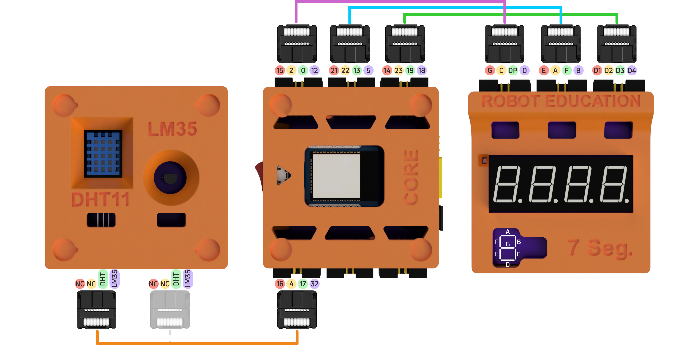
* **Contoh Program Dasar:** Anda bisa melihatnya di dalam folder Example Code dengan nama file [**07_Capstone_Project.ino**](Example%20Code/07_Capstone_Project.ino)
* **Hasil yang Diharapkan:** Layar 7-Segment akan menyala, di mana 2 digit paling kiri menampilkan nilai Suhu dan 2 digit paling kanan menampilkan persentase Kelembapan. Log nilai tersebut juga akan diprint ke Serial Monitor setiap 2 detiknya.